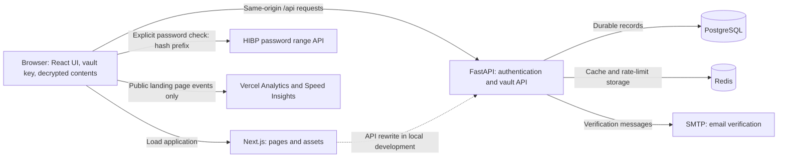
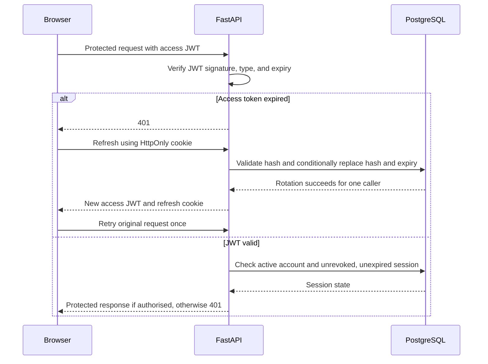

# Cipheria architecture

Cipheria keeps vault keys and decryption in the browser, authenticates requests through FastAPI, stores account-owned ciphertext in PostgreSQL, and caches derived responses in Redis. This guide follows those boundaries through the source files. Setup and commands are in the [README](../README.md).

## Contents

- [System overview](#system-overview)
- [Security and data boundaries](#security-and-data-boundaries)
- [Code organisation](#code-organisation)
- [Authentication and vault state](#authentication-and-vault-state)
- [Vault operations and search](#vault-operations-and-search)
- [Master password changes and exports](#master-password-changes-and-exports)
- [Persistence and caching](#persistence-and-caching)
- [Deployment and failures](#deployment-and-failures)
- [Where to change a behaviour](#where-to-change-a-behaviour)

## System overview

Cipheria has a Next.js frontend and a FastAPI backend. PostgreSQL stores durable application data. Redis supports caching and shared rate limiting. Vault encryption and decryption run in the browser through the Web Crypto API.

The routing layer exposes the frontend and API under one browser origin. In development, Next.js rewrites `/api/*` to the API origin. On Vercel, the service configuration routes `/api/*` directly to FastAPI. FastAPI's own routes begin with `/auth` and `/vault`; they do not add a second `/api` prefix.

## Security and data boundaries

### What is encrypted

| Data | Representation and location |
| --- | --- |
| Login credentials, website URL, card fields, notes, identity fields, previous login passwords | JSON encrypted in the browser; stored as `vault_items.encrypted_data` |
| Item name, category, favourite state, deletion state, timestamps | Unencrypted metadata in PostgreSQL; some responses are cached in Redis |
| Email, full name, master hint, vault salt, verification state | Server-readable account data; [user_cache.py](../api/user_cache.py) also caches ID, active state, and creation time, while excluding the verifier hash |
| Master password | Used locally to derive the vault key and authentication verifier; not sent as the raw password to the API |
| Authentication verifier | Sent to the API over HTTPS; stored as a bcrypt hash, not included in the profile cache |
| Access token | Browser memory; sent in the `Authorization` header |
| Refresh token | HttpOnly browser cookie; its SHA-256 hash is stored in PostgreSQL |
| Audit records | Server-readable action, account ID, IP address, user agent, and timestamp |

`list_items()` filters item names and categories in SQL; `compute_sidebar_counts()` aggregates category, favourite, and trash counts without decrypting anything. Those queries depend on the unencrypted columns above. Cipheria's encryption covers the contents inside `encrypted_data`.

### Key derivation and payload format

In [lib/crypto.ts](../lib/crypto.ts):

1. PBKDF2-SHA-256 derives 256 bits from the master password and the account's vault salt using 600,000 iterations.
2. The browser imports those bits as a non-extractable AES-256-GCM `CryptoKey` for vault encryption and decryption.
3. The authentication verifier is the hexadecimal SHA-256 digest of the derived bits. The API bcrypt-hashes that verifier with cost 12; see [api/crypto.py](../api/crypto.py).
4. Each encryption uses a fresh random 12-byte IV. The stored string is `base64(iv).base64(ciphertextWithAuthenticationTag)`.

The salt is available to the server and is not a secret. A new salt is generated when the master password changes. Changing these derivation parameters or the ciphertext format requires a migration strategy for existing encrypted items and exports.

The non-extractable key is held in `useAuthStore.cryptoKey`. Browser code with access to the unlocked application can still use that key to decrypt items. `lockVault()` drops the active key and list references; it cannot guarantee erasure of previously allocated JavaScript memory.

### External requests

- Website icons use local Lucide icons. Saved website domains are not automatically sent to a favicon provider.
- A user-triggered password exposure check hashes the password locally and sends only the first five hexadecimal SHA-1 characters to HIBP. Matching the remaining suffix happens locally. This is a lookup protocol, not the algorithm used to store passwords.
- [app/page.tsx](../app/page.tsx) mounts analytics on the public landing page. Its event filter checks both the event URL and current page, removes query strings, and discards auth and dashboard events even after client navigation.
- SMTP receives verification-message data. It does not receive vault payloads or master passwords.

## Code organisation

| Responsibility | Implementation |
| --- | --- |
| Public and authentication pages | [app/page.tsx](../app/page.tsx), [auth page](<../app/(auth)/auth/page.tsx>) |
| Registration and login submission | [useAuthForm.ts](../components/dashboard/hooks/useAuthForm.ts) |
| Dashboard orchestration and mutations | [dashboard/page.tsx](<../app/(dashboard)/dashboard/page.tsx>) |
| Dashboard presentation, forms, settings | [components/dashboard](../components/dashboard/) |
| Session restoration, lock, logout, idle handling | [useDashboardSession.ts](../components/dashboard/hooks/useDashboardSession.ts), [useIdleTimer.ts](../components/dashboard/hooks/useIdleTimer.ts) |
| View loading, pagination caches, search coordination | [useVaultViews.ts](../components/dashboard/hooks/useVaultViews.ts), [vaultView.ts](../components/dashboard/vaultView.ts) |
| Browser state and tab synchronisation | [lib/store.ts](../lib/store.ts), [lib/authSync.ts](../lib/authSync.ts) |
| Browser encryption, generation, strength estimation, search | [lib/crypto.ts](../lib/crypto.ts), [lib/passwordStrength.ts](../lib/passwordStrength.ts), [lib/vaultSearch.ts](../lib/vaultSearch.ts) |
| HTTP client, token attachment, refresh retries | [lib/api.ts](../lib/api.ts) |
| API assembly, middleware, health endpoint | [api/index.py](../api/index.py) |
| Authentication and authorisation | [api/routes/auth.py](../api/routes/auth.py), [api/deps.py](../api/deps.py) |
| Vault ownership, CRUD, export, response contracts | [api/routes/vault.py](../api/routes/vault.py), [api/schemas.py](../api/schemas.py) |
| Database, cache, counts, audit, rate limiting | [database.py](../api/database.py), [cache.py](../api/cache.py), [vault_counts.py](../api/vault_counts.py), [audit.py](../api/audit.py), [limiter.py](../api/limiter.py) |
| Schema evolution | [alembic/versions](../alembic/versions/) |

`CurrentSubject` validates the access token and its database session for reads. `DBUser` additionally loads the active `User` ORM object for write routes. Item routes constrain queries with both the requested item ID and the authenticated user's ID. The Next.js `proxy()` hook does not perform these checks.

## Authentication and vault state

### Registration and login

Registration generates a vault salt in the browser and sends the account details, salt, and derived verifier to the API. Login first obtains the salt through `/auth/login/challenge`, then derives the key and verifier locally. After verifier validation, the API creates a session and returns an access token and profile, and sets the refresh cookie. The browser retains the key in memory.

Authentication and decryption state are separate:

| State in `lib/store.ts` | Dashboard behaviour |
| --- | --- |
| `isAuthenticated=false` | Bootstrap attempts session restoration or redirects to `/auth` |
| `isAuthenticated=true`, `isVaultLocked=true`, `cryptoKey=null` | Shows `LockedVaultScreen`; the user must enter the master password |
| `isAuthenticated=true`, `isVaultLocked=false`, `cryptoKey` present | Shows `MainDashboard`; item contents can be decrypted locally |

A page reload loses the in-memory access token and key. A valid refresh cookie can restore authentication, but does not recover the key or automatically unlock the vault. [useVaultUnlock.ts](../components/dashboard/hooks/useVaultUnlock.ts) verifies the entered password, decrypts the initial item batch locally, and populates the first page before exposing the unlocked dashboard.

`useIdleTimer()` resets a five-minute timer on mouse, keyboard, touch, and scroll events. Locking clears the active key and vault list, and the dashboard clears selection and view/search caches. Logout also clears authentication state. [lib/authSync.ts](../lib/authSync.ts) publishes lock, logout, and profile events through the `cipheria-auth` BroadcastChannel and `cipheria:auth-event` localStorage key. Events include IDs, tab IDs, and optionally the user profile; they do not contain the vault key or item contents.

### Session rotation and revocation

Each `refresh_tokens` row represents one stable session. Access JWTs contain `sub` (account ID), `sid` (session-row ID), token type, and expiry. They last 15 minutes. Refresh JWTs last 30 days; successful rotation replaces the stored token hash and expiry on the same row.

The refresh cookie uses path `/` and is HttpOnly. Production sets `Secure` and `SameSite=None`; development uses `SameSite=Lax` without `Secure`. Deployment must provide the intended environment explicitly.

[api/deps.py](../api/deps.py) checks the session in PostgreSQL before protected data access, even when the response itself comes from Redis. This database lookup makes revocation effective before the access JWT's 15-minute expiry. Refresh uses a conditional update against the previous hash and active session state, so an old cookie cannot rotate twice or revive a revoked session. `lib/api.ts` shares `_refreshPromise` among concurrent failed requests within a tab; it is not shared across tabs.

Settings can revoke every other session after master-password verification. Logout revokes the current session. Revocation denies subsequent protected access and refresh; it does not erase information already viewed on another device. The dashboard rechecks its session when the browser window regains focus. Legacy refresh cookies can acquire a session-bound access token on refresh; legacy access tokens without `sid` do not authorise protected requests.

## Vault operations and search

### Create, read, update, and delete

- **Create/edit:** the browser builds the category-specific JSON payload, encrypts it, and sends ciphertext with listing metadata. The API validates the request and account ownership, commits the change, then invalidates affected caches.
- **List:** normal list responses contain metadata. Queries apply account ownership, category, favourite, trash, and optional name filters before pagination. Sorting is by `updated_at` descending and item ID ascending to resolve ties.
- **Open:** clicking an item fetches ciphertext when needed and decrypts it locally. Initial dashboard loads and category changes do not select an item automatically.
- **Favourite:** changing only favourite state preserves the content timestamp.
- **Delete/restore:** deletion normally moves an item to trash. Permanent deletion removes it. Trash is still part of the encrypted account data when changing the master password.

The shared store contains the current vault list and key. View caches and the search index belong to `useVaultViews`; selected item and mutation state belong to the dashboard page. Mobile panel navigation belongs to `MainDashboard`. The page's `currentSelectionRef` guards item responses, while `activeViewRef` prevents an older mutation from replacing the list after a category, search, or page change.

`hydrateViewFromLocalData()` derives another view from the cached All Items list only when that cache contains every active item and its total agrees with the sidebar count. A single page of All Items cannot represent a complete category. Incomplete caches and uncached Trash views require an API request.

### Search boundary

The API can search unencrypted item names. Searching encrypted usernames or website URLs must happen in the browser:

1. The browser requests all pages of the selected category, Favourites, or Trash with `include_encrypted_data=true`, in batches of up to 100.
2. Pages are fetched sequentially; login items within a page decrypt in parallel. Cancellation is checked between requests and completed batches.
3. The in-memory index retains username and URL search fields, without retaining the decrypted password or password history in that index.
4. Name, username, and URL matching is literal and case-insensitive. Results are paginated locally. Note contents, card fields, identity fields, and passwords are not searched.

Encrypted search batches bypass the normal metadata-list cache. The index is tied to its view and active key and is discarded on locking or invalidating the view. This supports private field matching at the cost of downloading and decrypting more data than a metadata-only list request.

### Password generation and history

Password generation uses Web Crypto randomness, rejection sampling to avoid modulo bias, and enabled character groups. Length is validated from 8 to 128, and each enabled group must appear in the result. Strength estimation uses the locally executed zxcvbn libraries; it does not send passwords to a scoring service.

Changing a login's saved password prepends the replaced password and replacement timestamp to `password_history`, retaining five entries. History is part of the existing encrypted payload, so it needs no additional database table. Editing an unchanged password does not add an entry. Revealing or copying history happens locally. Changing a vault entry does not change credentials on the corresponding website.

## Master password changes and exports

For a master password change, the browser derives a verifier from the entered current password, generates a new salt and key, and fetches every item, including trash. It decrypts each complete payload with the active old key and encrypts it with the new key, preserving password history and other payload fields.

The API verifies the current-password verifier and checks that the submitted item IDs exactly cover the account's items, then commits the replacement ciphertexts, salt, verifier hash, and revocation of other sessions in one database transaction. Client-side re-encryption happens before that transaction. The API cannot decrypt the supplied ciphertext to verify its contents. The current browser remains authenticated and locks its vault so the user unlocks with the new password.

Export produces JSON containing the vault salt, account email, item metadata, and ciphertext. Normal exports exclude trash; the master-password-change flow explicitly includes it. Exporting does not decrypt the item payloads or encrypt the surrounding metadata. An export made before a password change still requires the old password and the salt in that file to decrypt. There is currently no export-import or backup-restore UI; restoring an item from Trash is a different operation.

## Persistence and caching

[api/database.py](../api/database.py) defines the durable records:

| Table | Purpose |
| --- | --- |
| `users` | Account profile, verifier hash, vault salt, verification state |
| `vault_items` | Account-owned listing metadata, opaque ciphertext, trash state |
| `refresh_tokens` | Stable sessions, hashed refresh tokens, expiry, revocation |
| `auth_tokens` | Hashed, expiring action tokens such as email verification |
| `audit_logs` | Account security actions and request metadata |

[Pydantic schemas](../api/schemas.py) separate `VaultItemSummary` from `VaultItemResponse`, which adds `encrypted_data`. `UnlockedVaultResponse` adds required sidebar counts to the paginated response. PostgreSQL changes live in [alembic/versions](../alembic/versions/); for example, [0007_remove_favicons.py](../alembic/versions/0007_remove_favicons.py) drops the persisted `favicon_url` column, and its downgrade recreates the column without recovering deleted URLs.

Redis is a cache, not the durable store or the source of session authorisation:

| Cached data | Redis key | TTL in `api/cache.py` |
| --- | --- | --- |
| User profile, excluding verifier hash | `user:{user_id}` | 15 minutes |
| Metadata list responses | `vault:list:{user_id}:{version}:{params_hash}` | 5 minutes |
| Sidebar counts | `vault:sidebar:{user_id}:{version}` | 5 minutes |
| Individual item responses, including ciphertext | `vault:item:{user_id}:{item_id}` | 10 minutes |

`vault:list:ver:{user_id}` holds the version used by list and sidebar keys. Mutations increment it and invalidate the individual item as needed. Master-password changes invalidate the account profile and all vault caches. Cache reads return a miss when Redis is disabled or a handled Redis operation fails, so the caller reads PostgreSQL. `api/limiter.py` configures its storage separately from the cache client: it uses the Redis URL from `get_redis_url()`, or `memory://` when no URL is configured.

## Deployment and failures

- [vercel.json](../vercel.json) describes separate Next.js and FastAPI services with shared-origin routing.
- [next.config.js](../next.config.js) supplies API rewrites for host or Docker development. [proxy.ts](../proxy.ts) passes through auth navigation rather than treating cookie presence as proof of an active session.
- [Dockerfile](../Dockerfile) and [api/Dockerfile](../api/Dockerfile) build the frontend and backend independently. [Compose development overrides](../docker-compose.dev.yml) add local PostgreSQL, Redis, hot reload, and startup migrations.
- [api/database.py](../api/database.py) uses SQLAlchemy `NullPool`, with a default five-second connection timeout when the URL does not specify one. API requests do not share a retained application connection pool across Vercel instances.
- `JWT_SECRET` must remain configured across instances and deployments. Missing configuration fails startup rather than silently generating a new signing secret.
- Database connection failures are mapped to HTTP 503. `/health` reports Redis state but is not a full database readiness check. Missing SMTP configuration prevents verification-message delivery; the account's verification state still exists independently.
- In production, `get_client_ip()` checks `x-forwarded-for`, then `x-real-ip`, then the direct client address. Audit logging and the rate limiter use that result. `api/index.py` reads browser origins from `ALLOWED_ORIGINS` and enables credentialed CORS.

Use the [README deployment instructions](../README.md#configuration-and-deployment) for environment variables and migration commands.

## Where to change a behaviour

| Change | Connected implementation and verification |
| --- | --- |
| Add an encrypted item field | Update `DecryptedPayload` in [lib/types.ts](../lib/types.ts), `ItemForm` and `emptyForm` in [dashboard/types.ts](../components/dashboard/types.ts), the field definition and category form in [ItemModal.tsx](../components/dashboard/ItemModal.tsx), `buildPayload()` in [utils.ts](../components/dashboard/utils.ts), and `handleOpenEdit()` in the [dashboard page](<../app/(dashboard)/dashboard/page.tsx>). Item details read `ITEM_FIELDS`. Payload-only fields do not require a new PostgreSQL column. |
| Change password generation, history, or derivation | Start in [lib/crypto.ts](../lib/crypto.ts) and [passwords.test.mjs](../tests/passwords.test.mjs). Derivation or ciphertext-format changes must also account for existing items, the server verifier, and exports made with the old format. |
| Change searchable fields | Update `itemMatchesSearch()` and `loadSearchItems()` in [lib/vaultSearch.ts](../lib/vaultSearch.ts), and the retained `search_fields` shape in [lib/types.ts](../lib/types.ts). [vaultSearch.test.mjs](../tests/vaultSearch.test.mjs) checks matching, later pages, cancellation, and exclusion of decrypted passwords from the index. |
| Change session validation or revocation | Keep [api/deps.py](../api/deps.py), the session helpers in [auth.py](../api/routes/auth.py), and refresh handling in [lib/api.ts](../lib/api.ts) aligned. `SessionTests` in [test_vault_updates.py](../api/tests/test_vault_updates.py) covers rotation, replay, revocation, legacy-cookie upgrade, and disabled/deleted accounts. |
| Change item metadata or list responses | Coordinate [api/database.py](../api/database.py), [api/schemas.py](../api/schemas.py), [vault.py](../api/routes/vault.py), and the browser types. `VaultUpdateTests` in [test_vault_updates.py](../api/tests/test_vault_updates.py) checks timestamps, filtering, counts on unlock, response shapes, and cache bypass for encrypted batches. |
| Change how `/api` reaches FastAPI | Check [next.config.js](../next.config.js), [vercel.json](../vercel.json), and [docker-compose.dev.yml](../docker-compose.dev.yml) together. Host development, Docker development, and Vercel mount the same API through different routing configurations. |

Update the affected section of this guide when one of these changes alters the documented behaviour. Commands remain in the [README development checks](../README.md#development-checks).
