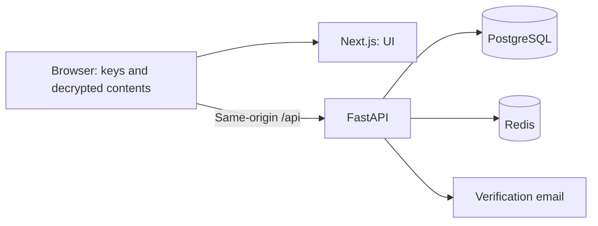

# Architecture

## Services

[next.config.js](../next.config.js) rewrites `/api/*` for local/Docker development. [vercel.json](../vercel.json) routes it directly to FastAPI; [api/index.py](../api/index.py) sets the Vercel ASGI root path to `/api`. API routes themselves start at `/auth` and `/vault`.

## Data and sessions

| Storage | Contents |
| --- | --- |
| `users` | Profile, bcrypt verifier hash, salt and nullable protected key envelope |
| `vault_items` | Encrypted payload, readable name/category/favourite/trash metadata, timestamps and revision |
| `refresh_tokens`, `auth_tokens` | Hashed session/action tokens and expiry/revocation state |
| `vault_imports` | Account-scoped import retry receipts |
| `audit_logs` | Action, account ID, IP, user agent and timestamp |

The browser retains the access token and non-extractable vault key in memory. Login derives a verifier using parameters from `/auth/login/challenge`; the raw master password stays local. A refresh cookie restores authentication after reload, but the password is still required to unlock. [Key derivation and formats](key-management.md).

Access JWTs last 15 minutes and identify a session row; refresh JWTs last 30 days. [api/deps.py](../api/deps.py) checks the account and session in PostgreSQL on protected requests, including cache hits. Refresh conditionally replaces the stored token hash so an old token cannot rotate twice. [lib/api.ts](../lib/api.ts) shares refresh attempts within a tab and retries a failed request once.

Locking after five idle minutes clears the active key and decrypted views. [authSync.ts](../lib/authSync.ts) synchronizes lock, logout and profile changes across tabs without sending keys or item contents. Logout revokes the current session; Settings can revoke the others after password verification.

## Vault writes and search

[vault.py](../api/routes/vault.py) checks ownership and serializes item writes, imports and key changes under an account row lock.

- Item CRUD writes require `X-Vault-Salt`; existing-item changes also require `If-Match: "<item UUID>:<revision>"`. Missing preconditions return 428, stale revisions 412 and obsolete salts 409.
- Retained items advance their revision on mutation. Favourite changes preserve the content timestamp. Permanent deletion requires Trash.
- Conflicting edits retain their draft for explicit reload or saving separately. Write responses are serialized before releasing the lock. Cached plaintext is reused only for matching revisions.
- Complete All Items caches can supply other active views; switching to Trash fetches it. Late mutation results refresh the current view rather than replace it with an old one.

The API filters readable names/categories. [vaultSearch.ts](../lib/vaultSearch.ts) fetches ciphertext in pages of 100 and builds a local name/username/URL index without retaining passwords in that index. Search and pending unlock/import work are cancelled when their account/key context changes.

Password generation uses Web Crypto randomness with rejection sampling; strength estimation runs locally. The last five replaced login passwords remain inside the encrypted payload.

## Import and export

[csvImport.ts](../lib/csvImport.ts) parses comma-delimited CSV as strings, preserving password whitespace, quotes, newlines and Unicode. Chrome/Edge headers are recognized; other layouts use manual mapping. Nonempty omitted columns require acknowledgement except recognized browser metadata. Fixtures cover synthetic layouts, not every browser/version.

[vaultImport.ts](../lib/vaultImport.ts) decrypts JSON 1.0/2.0 sources locally, validates payloads and shares CSV's preview/encryption path. Imported items receive new IDs and destination encryption; dates, favourites, supported fields and password history are preserved. Restored items are active, including any exported from Trash.

| Limit | Value |
| --- | --- |
| Source file | 2 MiB; 1-1,000 records/items |
| Prepared API request | 3 MiB |
| Destination capacity | 1,000 active items |

Duplicate checks compare active destination items and selected source records locally; dates/favourites do not affect equality. Empty optional fields/history equal absent values. Checks reflect preview-time contents and cannot deduplicate separate concurrent imports.

`POST /vault/import/json` takes `destination_salt`, an operation UUID and destination-encrypted items. A transaction validates salt/capacity and saves items, receipt and audit event together. Identical retries return the saved count; reusing an operation ID with different content returns 409. Keep the same preview for **Retry import**. Closing/locking cannot retract a committed request.

Normal JSON exports exclude Trash and include ciphertext plus readable metadata and the salt; version 2 also includes the protected key envelope and original IDs. Restore requires the export-time password. Full key changes include Trash; their transaction rules are in [key management](key-management.md#changes-and-migration).

## Redis and operational behavior

[cache.py](../api/cache.py) caches profiles without verifier hashes (15 minutes), metadata lists/sidebar counts (5 minutes) and item responses including ciphertext (10 minutes). Lists/items use `v2` namespaces; a per-account list version invalidates old views. Key changes invalidate account/vault caches. Disabled or failed cache reads fall back to PostgreSQL.

Rate limiting uses Redis when configured, otherwise process-local memory. Production client IPs come from forwarded headers, so the hosting proxy must sanitize them. PostgreSQL uses `NullPool`; connection failures return 503. `/health` reports Redis state, not full database readiness.

## Test setup

For PostgreSQL integration tests, set `TEST_DATABASE_URL` to a local database named `cipheria_import_test`. Tests create/remove isolated schemas; without this variable PostgreSQL cases skip. Never use the application database.

For browser tests, set `DATABASE_URL` and `E2E_DATABASE_URL` to that disposable database in a separate terminal and apply migrations. Keep `api/.env` unchanged. Set `INTERNAL_API_ORIGIN=http://127.0.0.1:8018`, run `pnpm build`, `pnpm exec playwright install chromium`, then `pnpm test:e2e`. The runner starts the API on 8018 and frontend on 3318, restarts between spec files and retains API rate limits. Browser artifacts are disabled; synthetic accounts remain in the disposable database.

`pnpm typecheck` generates Next.js types before using the TypeScript 7 compiler alias; Next.js/ESLint use the TypeScript 6 API compatibility package. ESLint excludes generated `next-env.d.ts`. The workspace's `pmOnFail: ignore` keeps the lockfile compatible with GitHub's dependency graph and disables automatic pnpm switching; use the pinned version ([upstream issue](https://github.com/dependabot/dependabot-core/issues/15904)).
